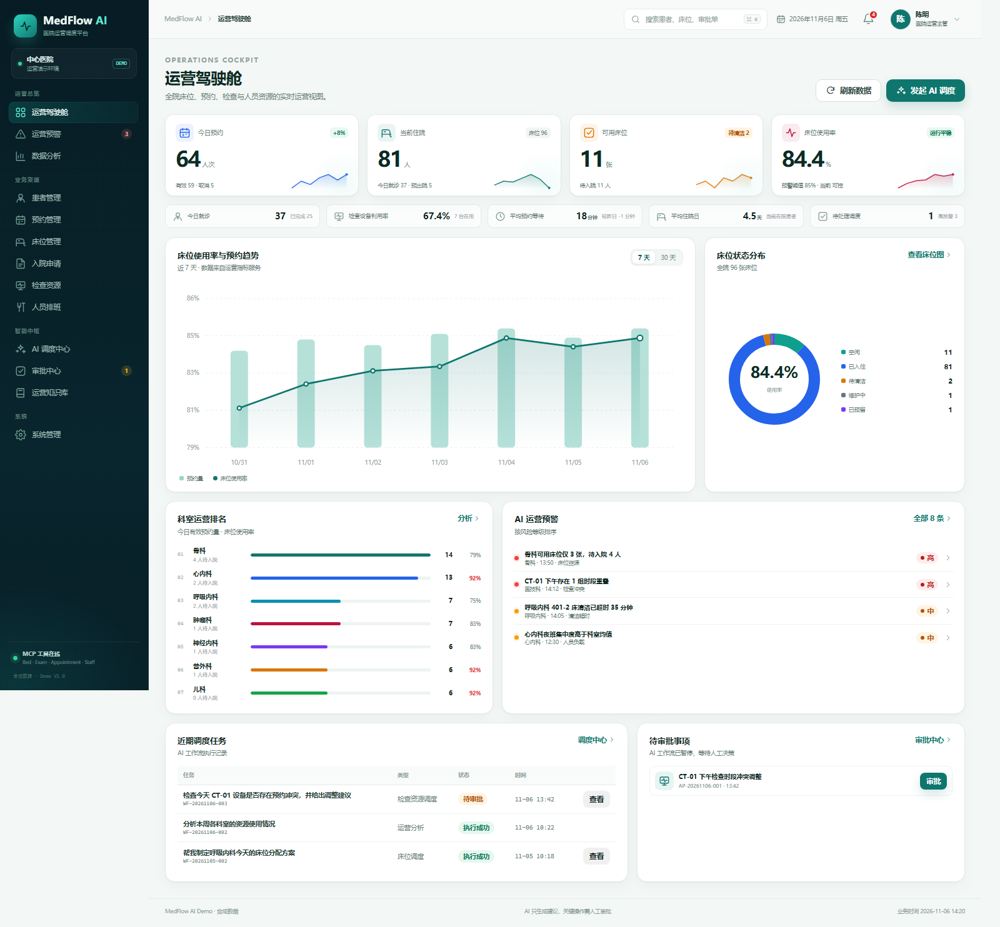
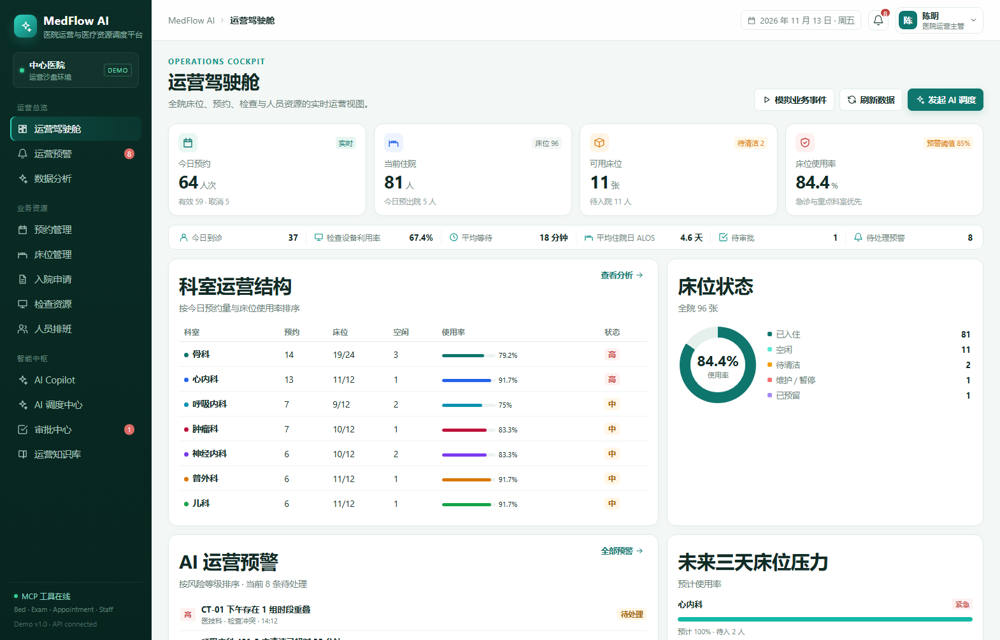
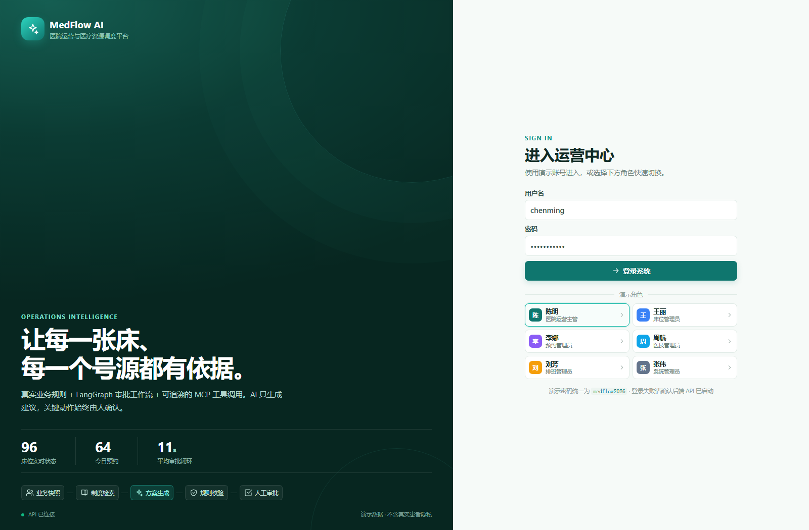
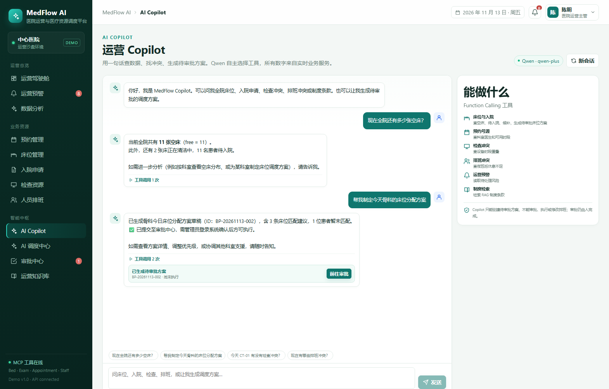
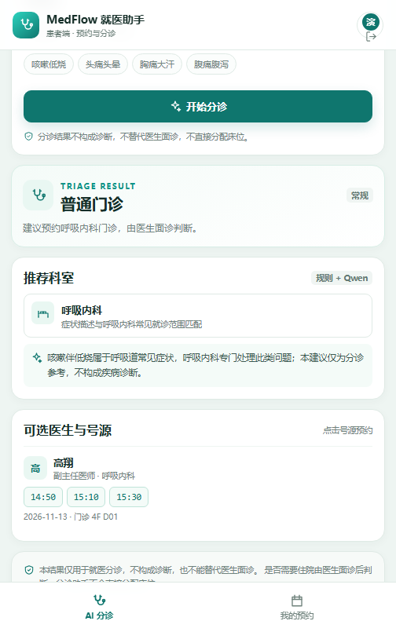
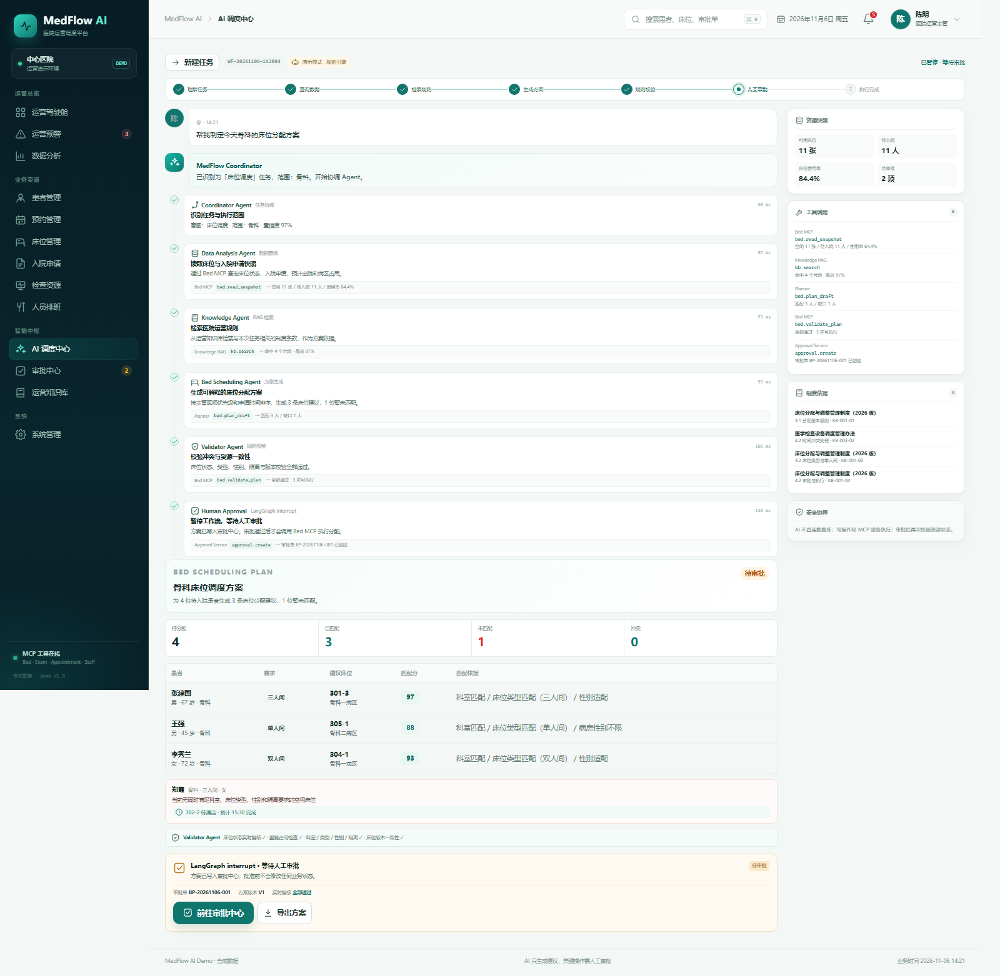
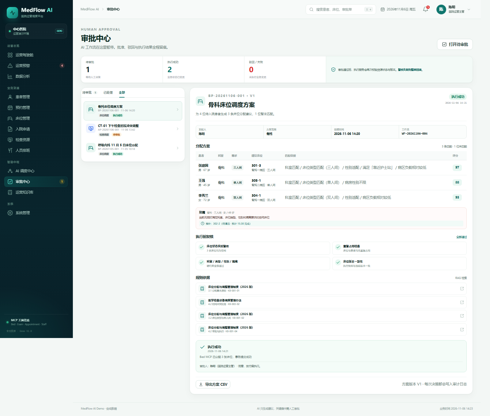

# MedFlow AI · 医院运营与医疗资源调度平台

**不是一张静态看板。** 改床位状态、审批或驳回一个方案、切换一个角色，页面和业务结果都会真的变化。

这个演示把 PRD 里最核心的闭环做成了可点击、可复现的产品原型：

> 输入一句运营指令 → Agent 查询医院数据 → RAG 检索制度 → 生成床位方案 → 规则校验 → LangGraph interrupt 等待审批 → 批准后通过 Bed MCP 执行 → 执行前再次复核 → 返回可追溯结果。



## 怎么打开

双击 **`打开演示.bat`**，或直接双击 `index.html`。

纯前端、零依赖、不联网、不需要安装 Python/Node。建议使用 Edge / Chrome。

直接以运营主管身份进入：

```text
index.html?auto=1&silent=1#/dashboard
```

登录页也可以点击角色卡直接进入。演示密码：`medflow2026`。

## 生产化前后端（已实现）

仓库现在包含两个独立前端和 **FastAPI** 后端；根目录 `index.html` 的零构建演示仍保留。

```powershell
# 终端 1：后端
cd backend
python -m pip install -r requirements.txt
python -m uvicorn app.main:app --port 8010

# 终端 2：医院内部运营端
cd web
npm install
npm run dev

# 终端 3：患者 H5（独立产品）
cd portal
npm install
npm run dev
```

- 医院内部运营端：`http://127.0.0.1:8010/app/login`（开发 `5173`）
- 患者就医助手：`http://127.0.0.1:8010/portal/login`（开发 `5174`）
- Swagger：`http://127.0.0.1:8010/docs`
- 原静态演示：`http://127.0.0.1:8010/demo/`
- 内部账号：`chenming` / `medflow2026`
- 患者账号：`patient` / `medflow2026`

后端包含 JWT + RBAC、SQLAlchemy（SQLite 默认 / PostgreSQL 可切换）、真实 LangGraph `interrupt` 审批工作流、持久化 SQLite checkpointer、独立 MCP Server。内部端通过 `/api/v1` 覆盖驾驶舱、预约、床位、入院、检查、排班、AI 调度、审批、预警、知识库、用户和分析；患者端独立使用 `/api/v1/portal/*`。详见 [`backend/README.md`](backend/README.md)、[`web/README.md`](web/README.md) 与 [`portal/README.md`](portal/README.md)。









## 3 分钟体验路径

1. **运营驾驶舱**：看 96 张床位、11 位待入院、8 条预警和今日运营趋势。
2. **AI 调度中心**：点「今日床位分配」，输入框会自动带入：
   `帮我制定今天骨科的床位分配方案`
3. 看 6 个 Agent 依次执行：Coordinator → Data → Knowledge → Bed Scheduling → Validator → Human Approval。
4. 结果：**3 位患者匹配成功，1 位（郑霞）暂无合适床位**；候补提示 `302-2` 预计 15:30 完成清洁。
5. 点「前往审批中心」，填写意见，点「批准并执行」。
6. 回到 **床位管理**：骨科最后 3 张空闲床位变为已入住；入院申请变为已分配；审计日志新增 Bed MCP 调用。
7. 再打开 **审批中心**，能看到执行成功、审批人、时间和审批意见。

### 看“拒绝不会改数据”

在审批中心选择 `CT-01 下午检查时段冲突调整`，填写驳回意见后点「驳回，不执行」。

- 检查时段保持 `14:45–15:15`，不会移动；
- 审批单状态变为「已驳回」；
- 审计日志记录 `plan.reject`。

### 看“审批期间资源变化会整单回滚”

1. 先生成一个床位方案，但不要审批；
2. 去床位管理，手动把方案里的一张空闲床分配给其他患者；
3. 回到审批中心批准原方案；
4. 执行前复核发现床位状态/版本变化，**0 张床位变更，整单回滚**。





## 演示账号与权限

| 账号 | 角色 | 能做什么 | 不能做什么 |
|---|---|---|---|
| 陈明 | 医院运营主管 | 全院运营、审批、预警处置、发起调度 | 无预约/排班操作权 |
| 王丽 | 床位管理员 | 床位分配/出院/清洁、发起床位方案 | 不能审批 |
| 李娜 | 预约管理员 | 新建/取消预约、号源 | 不能审批、不能改床位 |
| 张伟 | 系统管理员 | 全局配置、审计、全部权限 | — |
| 周航 | 医技科室管理员 | 设备、检查预约 | 不能审批床位 |
| 刘芳 | 医护排班管理员 | 人员、班次、排班 | 不能审批床位 |

> RBAC 在演示里由前端服务层模拟：写操作通过 `store.js` 做权限校验，审批另有人工确认。生产环境应由 FastAPI + JWT + 服务端权限中间件实现。

## 已实现的页面

| 页面 | 内容 |
|---|---|
| P01 登录 | 6 个角色、权限说明、演示账号快速进入 |
| P02 运营驾驶舱 | 9 项指标、床位趋势、状态分布、科室排名、预警、待审批、近期任务 |
| P03 患者管理 | 122 份合成档案、住院/待入院/门诊筛选、患者详情 |
| P04 预约管理 | 今日/明日号源、候补队列与补位、签到/完成、改约、AI 推荐、重复/冲突校验 |
| P05 床位管理 | 8 个病区、96 张床位、状态图、手动分配、出院、清洁、维护 |
| P06 入院申请 | 11 条申请、床位需求、临床优先级、AI 方案入口 |
| P07 检查资源 | CT/MRI/超声/DR、新建/取消检查、设备维护、排程时间轴、时段冲突 |
| P08 人员排班 | 21 人、7 天排班表、请假/调班、夜班间隔冲突、AI 排班方案与审批 |
| P09 AI 调度中心 | 自然语言意图、Agent 执行轨迹、MCP 工具调用、RAG 引用、方案结果、审批暂停 |
| P10 审批中心 | 待审批/已处理、执行前复核、批准/驳回、执行结果、审计 |
| P11 运营预警 | 8 条预警、等级/状态筛选、风险原因、AI 分析与处置 |
| P12 数据分析 | 7/30 天趋势、科室使用率、设备利用率、平均住院日、AI 报告、CSV 导出 |
| P13 知识库 | 6 份制度、19 个片段、向量 + 关键词检索、文本导入、上传/编辑/删除 |
| P14 系统管理 | 用户新增/编辑/停用、角色权限矩阵、审计日志、演示边界、重置数据 |

## 本轮补齐的功能

- **预约**：候补队列、补位、签到、完成、改约、取消；补位和改约都会重新检查重复预约与号源占用。
- **检查**：新建检查、冲突阻断、推荐空档、取消检查、设备转入维护/恢复运行；有未完成检查时禁止维护。
- **排班**：请假登记、调班、夜班 11 小时间隔校验、AI 排班调整方案、审批后发布；冲突解除后自动从冲突列表移除。
- **预警**：规则引擎重新计算床位缺口、清洁超时、设备冲突、人员冲突、取消率和未来床位风险。
- **分析**：增加平均住院日（ALOS）指标。
- **知识库**：文本文件导入、文档编辑并重建索引、64 维哈希向量 + 关键词混合检索。
- **系统**：新增用户、编辑角色/部门、停用/启用账号。
- **AI Copilot**：Qwen Function Calling 多轮对话，自主选择床位/预约/检查/排班/预警/知识库工具，生成待审批方案。
- **AI 调度**：新增「排班调度」意图，可生成排班草案并进入人工审批。
- **床位候补**：未匹配患者自动进入床位候补队列，保留原始需求和未匹配原因，按优先级/申请时间排序。
- **床位释放重匹配**：清洁完成、床位空闲后自动扫描同科室待入院患者，生成新的待审批床位方案。
- **24 小时主动预警**：预测未来 24 小时床位缺口，生成预警并自动创建床位方案草稿，仍需人工审批。
- **演示事件模拟器**：驾驶舱「模拟业务事件」可显式新增患者/入院申请、模拟出院释放床位，触发自动重匹配；不会在每次登录时随机换人。

## 什么是真的，什么是模拟的

### 真实计算

- **床位匹配**：科室、床位类型、性别、隔离、设施要求作为硬约束；主管医师优先级和申请时间用于排序；不自动跨越临床优先级。
- **冲突检测**：床位重复占用、状态、版本、性别、类型、隔离；检查设备时间重叠（15 分钟重叠可复现）。
- **执行事务**：先全量复核，再一次性提交；任意一项失败则 0 条变更。`version` 字段专门用于发现审批期间的变化。
- **RAG 检索**：对 19 个制度片段做 64 维哈希向量 + 关键词混合检索，返回相关度、向量分和出处；方案中的引用可点回原文。
- **指标与报告**：床位使用率、设备利用率、平均住院日、预约取消率、平均等待、工作负载都由数据计算，报告只组织这些数字。
- **排班规则**：夜班后 11 小时间隔、连续夜班检查，生成可审批的排班调整方案；批准后才发布。
- **预警规则引擎**：床位使用率、科室缺口、清洁超时、设备冲突、人员冲突、取消率等阈值实时计算。
- **持久化**：审批、分配、出院、预警处置、候补、检查、排班、用户和知识库操作写入 `localStorage`，刷新不丢。
- **审计**：方案创建、批准/驳回、MCP 调用、床位操作、预约变更、检查变更、排班发布、知识库操作都写日志。

### 演示版模拟

- **在线大模型**：未接真实通义千问。自然语言由规则意图识别 + 模板组织，所有结论依赖确定性引擎。
- **LangGraph**：用浏览器内的异步状态机模拟节点、interrupt、resume 与工具轨迹；生产版由服务端 LangGraph + checkpointer 实现。
- **MCP**：工具在页面进程内以适配器形式执行，展示调用参数、结果和耗时；生产版是独立 MCP Server。
- **数据库 / 认证**：`localStorage` 代替 PostgreSQL；前端权限表代替 JWT + RBAC 中间件。
- **患者数据**：全部为合成数据，不含真实隐私信息。

生产化接口、表结构和迁移路径见 [`docs/architecture.md`](docs/architecture.md)、[`docs/api.md`](docs/api.md)、[`db/schema.sql`](db/schema.sql)。

## 核心业务规则

### 床位调度

1. 只从 `空闲` 床位中选；`待清洁`、`维护中`、`已预留`、`暂停使用` 不参与。
2. 科室、床位类型、性别、隔离要求是硬约束，不做自动降级。
3. 排序只使用主管医师标注的优先级 + 申请时间，不推断临床紧急程度。
4. 预计今日出院床位只作为候补提示，必须在出院 + 终末清洁后重新进入候选池。
5. 方案写入审批单，不直接改床位。
6. 审批通过后再次校验 `床位状态 + 版本 + 患者状态`，全部通过才事务提交。

### 检查调度

1. 先按设备能力、维护窗口、检查项目校验。
2. 发现时段重叠时，仅调整 `常规` 检查到最近空档。
3. `优先 / 紧急` 检查保持原时段；无法自动调整时提交人工协调。
4. 执行前再次校验原时段、目标时段和患者状态。

### 预约规则

- 同患者、同医生、同日不得重复预约；
- 同一医生同一号源只能被一个有效预约占用；
- 取消释放号源，候补按登记时间排序；
- 候补补位前重新校验重复预约和号源占用；
- 改约重新进入待确认，签到/完成按状态机流转；
- AI 只推荐，不自动提交。

## 知识库内容

| 文档 | 片段 |
|---|---:|
| 床位分配与调整管理制度（2026 版） | 5 |
| 门诊预约与号源管理规范 | 3 |
| 医学检查设备调度管理办法 | 3 |
| 医护排班与工作负载规则 | 3 |
| 运营预警分级与处置流程 | 2 |
| AI 运营助手使用与审计规范 | 3 |

检索示例：`床位分配 单人间 审批`、`CT 时间冲突 临床优先级`、`夜班 间隔 11 小时`。

## 数据规模

全部为固定种子的合成数据：

| 数据 | 数量 |
|---|---:|
| 病区 / 床位 | 8 / 96 |
| 住院患者 | 81 |
| 待入院申请 | 11 |
| 门诊档案 | 30 |
| 预约（今日 + 明日） | 64 + 36 |
| 候补队列 | 8 |
| 检查（3 天） | 309（今日 123） |
| 医护人员 / 排班冲突 | 21 / 2 |
| 运营预警 | 8（规则引擎可新增） |
| 知识文档 / 片段 | 6 / 19 |
| 演示账号 | 6 |

初始状态：床位使用率 **84.4%**，空闲 **11** 张，待清洁 **2** 张，维护 **1** 张，预留 **1** 张。

## 文件结构

```text
medflow-ai/
├─ 打开演示.bat
├─ index.html
├─ styles.css             # 基础、布局、登录、驾驶舱、表格
├─ styles-pages.css       # 床位、检查、排班、审批、调度、弹窗
├─ README.md
├─ screenshot.png
├─ screenshot-login.png
├─ screenshot-workflow.png
├─ screenshot-approval.png
├─ js/
│  ├─ data.js        # 合成医院数据、制度、预案
│  ├─ engine.js      # 床位算法、冲突检测、RAG、指标、意图识别
│  ├─ store.js       # 状态、RBAC、审批、事务执行、审计、持久化
│  ├─ ui.js          # 图标、组件、SVG 图表
│  └─ app.js         # 路由、14 个页面、工作流编排、交互
├─ backend/          # FastAPI 生产化后端（JWT/LangGraph/MCP/pytest）
│  ├─ app/
│  ├─ mcp_server.py
│  ├─ tests/
│  └─ README.md
├─ web/              # 医院内部运营端（Vue 3 + Vite + Pinia）
│  ├─ src/           # 13 个业务页面、JWT store、API client、路由守卫
│  ├─ tests/         # smoke.mjs / flows.mjs
│  ├─ screenshots/
│  └─ README.md
├─ portal/           # 患者就医助手 H5（独立患者端）
│  ├─ src/           # 患者登录、分诊、预约成功、我的预约
│  ├─ tests/
│  ├─ screenshots/
│  └─ README.md
├─ tests/
│  ├─ test_engine.js       # 17 个纯领域测试
│  ├─ browser_smoke.js     # 12 项核心闭环浏览器测试
│  ├─ browser_features.js  # 27 项新增功能浏览器测试
│  └─ capture_final.js     # 重新生成截图
├─ docs/
│  ├─ architecture.md
│  ├─ api.md
│  └─ mcp.md
└─ db/
   └─ schema.sql
```

## 测试

```powershell
# 领域算法 / 规则 / RAG / 预测
node tests/test_engine.js

# 核心闭环：登录、跑 Agent、审批、执行、持久化、驳回、RBAC、冲突
node tests/browser_smoke.js

# 新增功能：候补/签到/改约、检查 CRUD、设备维护、排班方案、预警、知识库、用户
node tests/browser_features.js

# 后端：JWT/RBAC、LangGraph interrupt/resume、原子执行、回滚、MCP
cd backend
python -m pytest tests -q

# 医院内部运营端：登录、页面渲染、表单交互、审批、AI 工作流
cd ../web
node tests/smoke.mjs
node tests/flows.mjs

# 独立患者端：登录、分诊、预约、我的预约、签到
cd ../portal
node tests/smoke.mjs

# 重新生成零构建演示截图（需要本机 Edge）
cd ..
node tests/capture_final.js
```

当前结果：

```text
17 tests passed（零构建领域）
SMOKE OK · 12 checks（零构建核心）
FEATURES OK · 27 checks（零构建新增功能）
20 passed（FastAPI pytest）
WEB SMOKE OK · 20 checks（内部运营端）
FLOWS OK · 9 checks（内部运营端）
PORTAL SMOKE OK · 7 checks（患者端）
```

`browser_smoke.js` 和 `browser_features.js` 需要本地 8765 预览服务运行。

浏览器测试需要 Microsoft Edge（脚本里写死了默认安装路径，可改 `EDGE` 常量）。

## 生产化下一步

1. 规则、事务、LangGraph 和 Vue3 前端均已落地；下一步把默认 SQLite 换成 PostgreSQL，并用 `PostgresSaver` 替换 SQLite checkpointer。
2. 通义千问 adapter 已完成（DashScope OpenAI-compatible）；配置 `DASHSCOPE_API_KEY` 后启用，只做语言组织，数字仍来自统计服务。
3. 接入医院统一认证、患者主索引（EMPI）、HIS/EMR/设备系统，保留人工审批和审计。
4. 生产补齐 Redis 限流、审计 outbox、Prometheus 指标、备份与密钥轮换。
5. 把 `web/dist` 接入 Nginx/CDN，API 反代到 FastAPI。

## 边界

- 这是**产品原型 + 可执行演示**，不是可直接上线的生产系统。
- 不做 AI 问诊、诊断或治疗建议；不改变临床优先级。
- 不自动跨科室占用床位；单人间/监护床/隔离间不自动降级。
- Vue3 前端已接入真实 API；Qwen adapter 已实现，填入 `DASHSCOPE_API_KEY` 即可使用，未配置时回退规则摘要。
- 医院统一认证仍需医院 IdP 的 issuer/client 凭据。
- 根目录零构建演示仍使用 localStorage，它是独立可运行的产品原型，不是 Vue 前端的运行依赖。
- 后端默认 SQLite + SQLite checkpointer，适合单机；多实例生产需 PostgreSQL + PostgresSaver。
- 数据是合成的；演示环境不使用真实患者隐私信息。


